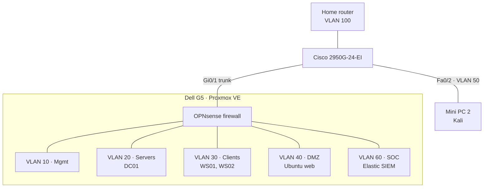

# Purple Team Lab
 
A segmented, Microsoft-style business network built on a single Proxmox hypervisor, used to emulate attacks, collect telemetry in Elastic Security, and build detections as code (Sigma, Elastic rules, YARA).
 
**Status:** 🟡 Build phase. Proxmox is installed; SIEM switched from Wazuh to Elastic.
 
## Goals
 
- **Detection engineering:** emulate ATT&CK techniques, capture telemetry, write and validate detections, document false positives and gaps.
- **Networking:** VLAN design, 802.1Q trunking, switch hardening, firewall policy with written rationale.
- **Systems:** Proxmox, Windows Server Active Directory, Group Policy, Windows 11, Linux.
## Hardware
 
| Device | Specs | Role |
| --- | --- | --- |
| Dell G5 5000 | i5-10400F (6c/12t), 32 GB RAM, 2 x ~476 GB SSD | Proxmox VE hypervisor |
| Lenovo ThinkCentre (mini PC 1) | i3-4130T, 8 GB RAM | Spare / second DMZ target |
| Lenovo ThinkCentre (mini PC 2) | i3-4130T, 8 GB RAM | Kali Linux attacker (bare metal) |
| Cisco WS-C2950G-24-EI | 24 x 100 Mbps, 2 x GBIC gigabit | Core switch, 802.1Q trunk |
 
## Architecture
 

 
OPNsense is the only path between zones, with default deny between every zone. Every cross-zone move an attacker makes lands in firewall logs.
 
| VLAN | Name | Subnet | Hosts |
| --- | --- | --- | --- |
| 100 | Home | Home LAN | Proxmox mgmt, OPNsense WAN |
| 10 | Mgmt | 10.10.10.0/24 | Switch SVI, OPNsense admin |
| 20 | Servers | 10.10.20.0/24 | DC01 (`lab.local`) |
| 30 | Clients | 10.10.30.0/24 | WS01, WS02 |
| 40 | DMZ | 10.10.40.0/24 | Ubuntu web target |
| 50 | Attacker | 10.10.50.0/24 | Kali (mini PC 2) |
| 60 | SOC | 10.10.60.0/24 | Elastic SIEM (VM) |
| 999 | Dead | none | Trunk native VLAN, unused ports |
 
## Repository layout
 
```
├── README.md
├── 00-build/                 hypervisor install, storage, ISO hashes, build log
├── 01-network/               switch config, OPNsense, firewall rules + rationale
├── 02-active-directory/      domain build, GPOs, intentional misconfigurations
├── 03-logging/               Sysmon, audit policy, Elastic Agent + Fleet policies
├── detections/
│   ├── sigma/                source of truth
│   ├── elastic/              generated Elastic detection rules
│   ├── kql/                  generated from Sigma
│   └── yara/
├── scenarios/                one folder per attack → detect write-up
├── coverage/                 ATT&CK Navigator layer
└── docs/                     design decisions
```
 
## Progress
 
- [x] Architecture and VLAN design ([design decisions])
- [x] SIEM evaluation: Wazuh installed, replaced by Elastic ([write-up])
- [x] Proxmox installer USB
- [x] Proxmox VE on the G5 ([build log])
- [ ] Elastic SIEM VM
- [ ] Switch config and VLAN-aware bridge
- [ ] OPNsense, VLANs, firewall policy
- [ ] DC01 and `lab.local` domain
- [ ] Workstations, Sysmon, Elastic Agents
- [ ] Kali and DMZ target
- [ ] Scenario 001
 
